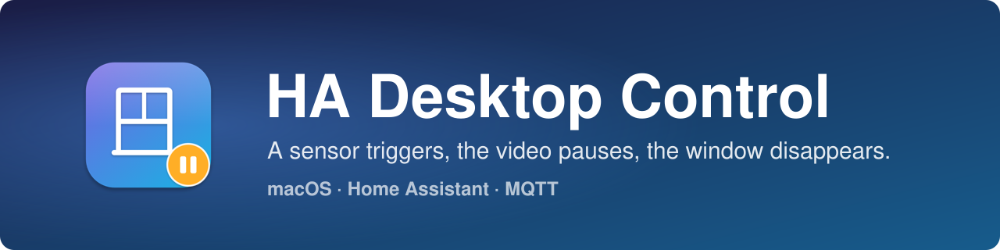
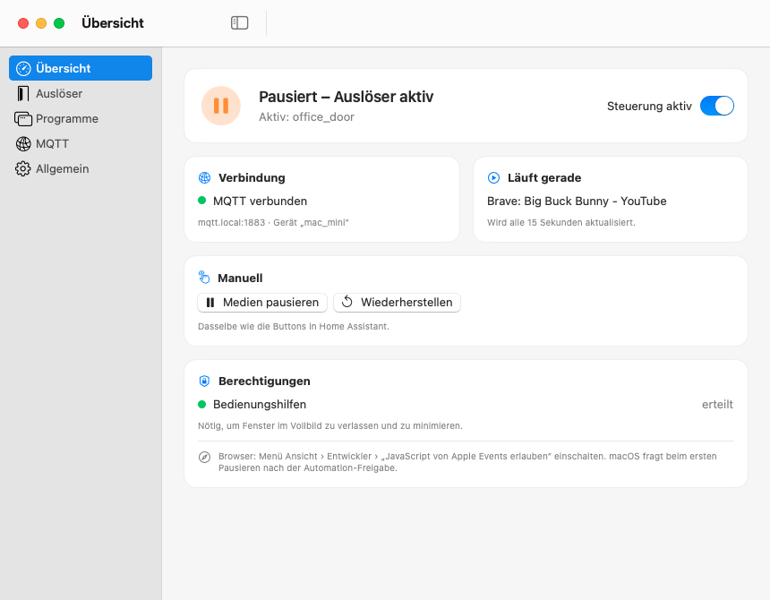
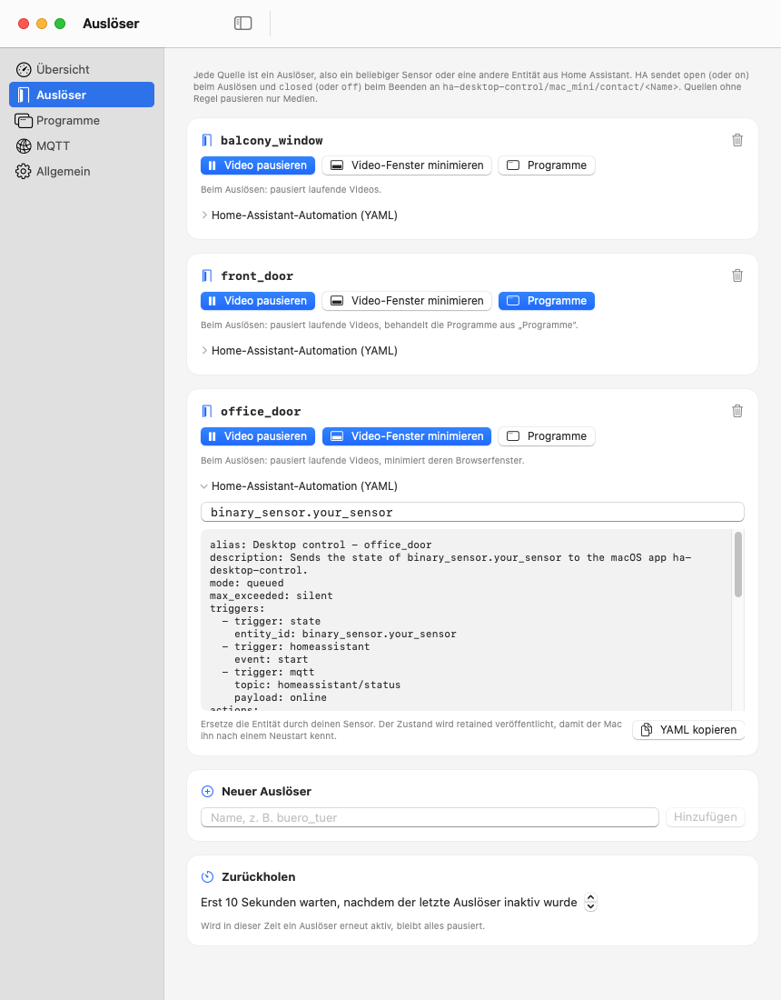
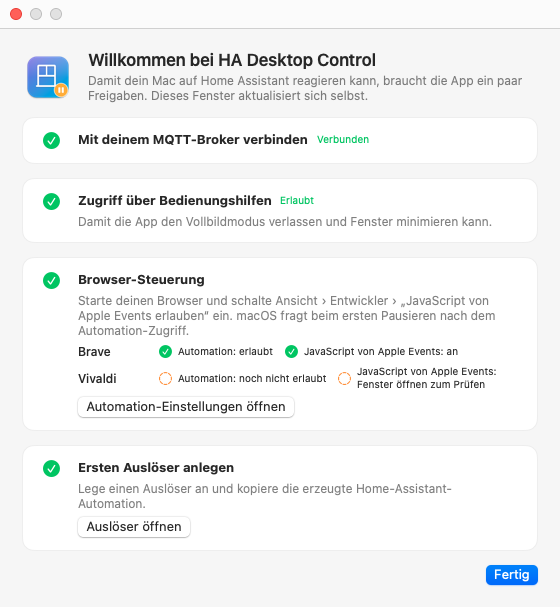

<div align="center">



</div>

# HA Desktop Control

**Eine native macOS-Menüleisten-App, die Browser-Videos pausiert und Fenster minimiert, wenn irgendein Home-Assistant-Sensor auslöst, und alles zurückholt, sobald er wieder frei ist.**

[](https://github.com/sphings79/ha-desktop-control/actions/workflows/ci.yml)
[](https://github.com/sphings79/ha-desktop-control/releases/latest)
[](LICENSE)
[](https://github.com/sphings79/ha-desktop-control/stargazers)
[](#voraussetzungen)
[](https://buymeacoffee.com/sphings)

[English](README.md) · **Deutsch**

## Warum es das gibt

Dein Mac weiß nicht, dass gerade jemand die Tür geöffnet hat. Du sitzt mitten in einem Film am Schreibtisch, die Tür geht auf, und der Bildschirm zeigt genau das, was niemand sehen sollte, während der Ton weiterläuft.

Home Assistant weiß von der Tür, vom Fenster, von der Bewegung im Flur und von der Klingel. Dein Mac nicht. HA Desktop Control schließt diese Lücke: Home Assistant sagt dem Mac per MQTT Bescheid, das Video pausiert, das Browserfenster verschwindet, und ein paar Sekunden nachdem der Auslöser wieder frei ist, kommt alles genau so zurück, wie es war.

<div align="center">
<picture>
  <source media="(prefers-color-scheme: dark)" srcset="docs/screenshot-overview-de-dark.png">
  
</picture>
</div>

## Inhalt

- [Was die App macht](#was-die-app-macht)
- [Welche Sensoren auslösen können](#welche-sensoren-auslösen-können)
- [So funktioniert es](#so-funktioniert-es)
- [Unterstützte Browser und Streamingdienste](#unterstützte-browser-und-streamingdienste)
- [Voraussetzungen](#voraussetzungen)
- [Installation](#installation)
- [Einrichtung](#einrichtung)
- [Einstellungen im Überblick](#einstellungen-im-überblick)
- [MQTT-Topics](#mqtt-topics)
- [Datenschutz und Sicherheit](#datenschutz-und-sicherheit)
- [Fehlersuche](#fehlersuche)
- [FAQ](#faq)
- [Mitmachen und unterstützen](#mitmachen-und-unterstützen)
- [Lizenz](#lizenz)

## Was die App macht

Wird ein Auslöser aktiv, pausiert die App alle laufenden `<video>`- und `<audio>`-Elemente in deinen Chromium-Browsern (Brave, Vivaldi, Chrome), auch wenn das Video im Vollbild läuft. Danach kann sie genau die Browserfenster minimieren, in denen das Video lief, und weitere Programme ausblenden, minimieren oder beenden, etwa einen Chat-Client.

Wird der letzte aktive Auslöser wieder frei, wartet die App eine einstellbare Zeit, holt die Fenster zurück und setzt die Videos fort. Rückgängig macht sie nur, was sie selbst getan hat: Drückst du zwischendurch selbst Play, wird nichts doppelt angefasst. Überlappen sich mehrere Auslöser, wird erst nach dem letzten zurückgeholt.

Jeder Auslöser hat eigene Regeln. So kann die Bürotür das Video pausieren und das Browserfenster verstecken, während das Balkonfenster nur pausiert. Der Mac erscheint per MQTT Discovery als Gerät in Home Assistant mit Schalter, Status-Sensor, „Läuft gerade“-Sensor und zwei Buttons und liest den retained Zustand der Auslöser nach einem Neustart oder einer Wiederverbindung neu ein. Die App ist in Swift und SwiftUI geschrieben, startet auf Wunsch bei der Anmeldung, speichert das Broker-Passwort im macOS-Schlüsselbund, unterstützt TLS ab 1.2 und folgt dem hellen oder dunklen Erscheinungsbild des Systems, oder einer festen Wahl. Die Oberfläche gibt es auf Deutsch und Englisch.

## Welche Sensoren auslösen können

Alles, was Home Assistant als „an“ oder „aus“ ausdrücken kann. Der App ist egal, was die Entität ist, sie bekommt nur `open` oder `closed` auf einem Topic:

- Tür- und Fensterkontakte
- Bewegungs- und Anwesenheitsmelder, zum Beispiel „jemand betritt den Raum“
- eine Klingel, ein Taster oder ein Schalter
- eine Person, die ankommt oder geht, ein Kalendereintrag, ein Zeitplan
- jedes Template oder jeder Helfer, etwa „Bett belegt“ oder „Besprechung läuft“

`open` (oder `on`, `true`, `1`) heißt: Auslöser aktiv. `closed` (oder `off`, `false`, `0`) heißt: wieder frei. Das Topic heißt aus historischen Gründen weiterhin `contact`.

## So funktioniert es

```
Beliebiger HA-Sensor ──► Home Assistant ──► MQTT-Broker ──► HA Desktop Control (macOS)
 binary_sensor            Automation         retained            │
 Bewegung, Tür ...        mqtt.publish       open | closed       ├─ <video>/<audio> in Browser-Tabs pausieren
                                                                 ├─ das Fenster mit dem Video minimieren
                                                                 └─ gewählte Programme ausblenden / minimieren / beenden
```

## Unterstützte Browser und Streamingdienste

| Browser | Status |
|---|---|
| Brave | getestet |
| Vivaldi | getestet (YouTube) |
| Google Chrome | gleiche AppleScript-Schnittstelle wie Brave, hier nicht getestet |
| Safari | noch nicht unterstützt |
| Opera GX | nicht möglich: Im AppleScript-Wörterbuch ist das Ausführen von JavaScript abgeschaltet |

Getestet mit YouTube, Netflix, Disney+ und Prime Video in Brave, auch im Vollbild. Das Pausieren arbeitet mit den Medienelementen der Seite, daher funktionieren andere Streamingseiten meist ebenfalls.

Ein Video im Vollbild wird zuerst verlassen, damit sich das Fenster minimieren lässt. Browser erlauben Video-Vollbild nur nach einem echten Klick, deshalb kann die App es nicht zurückholen. Das Fenster kommt ohne Vollbild zurück.

## Voraussetzungen

- macOS 14 (Sonoma) oder neuer, getestet unter macOS 27 mit Apple Silicon
- Home Assistant mit der MQTT-Integration und ein MQTT-Broker, zum Beispiel Mosquitto
- In jedem Browser: **Ansicht › Entwickler › JavaScript von Apple Events erlauben**
- Zum Bauen aus dem Quelltext: Xcode mit der Swift-6-Toolchain

## Installation

### Variante 1: Release herunterladen

1. Lade `HADesktopControl-<version>-macos-arm64.zip` vom [neuesten Release](https://github.com/sphings79/ha-desktop-control/releases/latest) herunter, entpacke es und verschiebe **HADesktopControl.app** nach `/Programme`.
2. Die App ist nicht notarisiert (Ad-hoc-Signatur). Beim ersten Start per Rechtsklick auf **Öffnen** gehen oder ausführen:
   ```sh
   xattr -dr com.apple.quarantine /Applications/HADesktopControl.app
   ```

Voraussetzung: Apple Silicon (arm64) und macOS 14 oder neuer.

### Variante 2: aus dem Quelltext bauen

```sh
git clone https://github.com/sphings79/ha-desktop-control.git
cd ha-desktop-control
swift test                      # optional: Unit-Tests ausführen
./scripts/build_app.sh          # erzeugt build/HADesktopControl.app
ditto build/HADesktopControl.app /Applications/HADesktopControl.app
open /Applications/HADesktopControl.app
```

Signiere mit einem festen Zertifikat, sonst fragt macOS nach jedem Neubau erneut nach den Berechtigungen:

```sh
SIGN_IDENTITY="<Zertifikatsname oder Hash>" ./scripts/build_app.sh
```

Ein kostenloses *Apple Development*-Zertifikat aus Xcode reicht (`security find-identity -v -p codesigning`).

## Einrichtung

1. App starten. In der Menüleiste erscheint ein Fenster-Symbol, und beim ersten Start öffnet sich der **Einrichtungsassistent** (Menü › *Einrichtungsassistent …* öffnet ihn erneut). Er listet die folgenden Freigaben mit Live-Status und einem Button, der die passende Systemeinstellung öffnet.
2. **Einstellungen › MQTT:** Host, Port, Benutzer und Passwort eintragen, eine **Geräte-ID** wählen (zum Beispiel `mac_mini`) und auf *Speichern & verbinden* klicken.
3. **Einstellungen › Übersicht:** Die Berechtigung **Bedienungshilfen** erteilen. Sie wird gebraucht, um den Vollbildmodus zu verlassen und Fenster zu minimieren.
4. Im Browser **JavaScript von Apple Events erlauben** einschalten. macOS fragt beim ersten Pausieren nach der **Automation**-Freigabe.
5. **Einstellungen › Auslöser:** Einen Auslöser hinzufügen (sein Name ist der letzte Teil des Topics) und festlegen, was er tut.
6. Unter dem Auslöser **Home-Assistant-Automation (YAML)** öffnen, die Entity-ID deines Sensors eintragen und die erzeugte Automation nach Home Assistant kopieren (siehe unten).

<div align="center">
<picture>
  <source media="(prefers-color-scheme: dark)" srcset="docs/screenshot-contacts-de-dark.png">
  
</picture>
</div>

### Einrichtung in Home Assistant

Die App legt das MQTT-Discovery-Gerät selbst an. **Die App schreibt dir die Automation:** Unter jedem Auslöser zeigt *Home-Assistant-Automation (YAML)* auf der Seite *Auslöser* eine fertige Automation für deine Entity-ID, mit Kopier-Button. Für jeden Auslöser legst du eine Automation an, die seinen Zustand **retained** veröffentlicht. Retained heißt: Der Mac erfährt den aktuellen Zustand auch nach einem Neustart oder einer unterbrochenen Verbindung:

```yaml
alias: Desktop control - Bürotür
mode: queued
max_exceeded: silent
triggers:
  - trigger: state
    entity_id: binary_sensor.buerotuer_kontakt
  - trigger: homeassistant
    event: start
  - trigger: mqtt
    topic: homeassistant/status
    payload: online
actions:
  - choose:
      - conditions:
          - condition: state
            entity_id: binary_sensor.buerotuer_kontakt
            state: "on"
        sequence:
          - action: mqtt.publish
            data:
              topic: ha-desktop-control/mac_mini/contact/buerotuer
              payload: open
              retain: true
      - conditions:
          - condition: state
            entity_id: binary_sensor.buerotuer_kontakt
            state: "off"
        sequence:
          - action: mqtt.publish
            data:
              topic: ha-desktop-control/mac_mini/contact/buerotuer
              payload: closed
              retain: true
```

Ersetze die Entität, die Geräte-ID (`mac_mini`) und den Auslösernamen (`buerotuer`). Für einen Bewegungs- oder Anwesenheitsmelder nimmst du dessen Entität, sein Zustand `on` wird zu `open`. Weitere Beispiele liegen in [`ha/`](ha/).

<div align="center">
<picture>
  <source media="(prefers-color-scheme: dark)" srcset="docs/screenshot-welcome-de-dark.png">
  
</picture>
</div>

## Einstellungen im Überblick

| Seite | Einstellung | Wirkung |
|---|---|---|
| MQTT | Host, Port, Benutzer, Passwort, TLS | Verbindung zum Broker; das Passwort liegt im Schlüsselbund |
| MQTT | Geräte-ID | Teil jedes Topics und des Gerätenamens in HA |
| Auslöser | Name | Letzter Teil von `…/contact/<Name>` |
| Auslöser | Video pausieren | Pausiert laufende Medien in den gewählten Browsern |
| Auslöser | Video-Fenster minimieren | Minimiert die Browserfenster, in denen ein Video pausiert wurde |
| Auslöser | Programme | Wendet die Regeln der Seite Programme an |
| Auslöser | Verzögerung | Sekunden, die nach dem letzten freien Auslöser gewartet wird (Standard 10) |
| Programme | App, Aktion | Minimieren, ausblenden oder beenden; optional zurückholen oder neu starten |
| Allgemein | Browser | Welche Chromium-Browser gesteuert werden |
| Allgemein | Darstellung | System, hell oder dunkel |
| Allgemein | Sprache | System, Deutsch oder Englisch |
| Allgemein | Beim Anmelden starten | Startet die App bei der Anmeldung |
| Allgemein | Updates | Tägliche Prüfung auf ein neues Release bei GitHub (abschaltbar) und die installierte Version |

Auslöser ohne Regel pausieren nur das Video.

## MQTT-Topics

Präfix: `ha-desktop-control/<device_id>`

| Topic | Richtung | Payload | Retained |
|---|---|---|---|
| `…/contact/<Name>` | HA → App | `open` / `closed` (auch `on` / `off`) | ja |
| `…/enabled/set` | HA → App | `ON` / `OFF` | nein |
| `…/cmd/pause_media` | HA → App | `PRESS` | nein |
| `…/cmd/restore` | HA → App | `PRESS` | nein |
| `…/availability` | App → HA | `online` / `offline` (Last Will) | ja |
| `…/enabled` | App → HA | `ON` / `OFF` | ja |
| `…/status` | App → HA | `idle` / `paused_by_contact` | ja |
| `…/now_playing` | App → HA | Tab-Titel oder `none` | ja |
| `…/audio/output` | App → HA | Name des aktuellen Ausgabegeräts | ja |
| `…/audio/output_type` | App → HA | `builtin_speaker` / `headphones` / `bluetooth` / `usb` / `hdmi` / `airplay` / `other` | ja |
| `…/audio/volume` | App → HA | `0`–`100`, oder `None`, wenn das Gerät keine Software-Lautstärke hat | ja |
| `…/audio/muted` | App → HA | `ON` / `OFF` | ja |
| `…/audio/output/set` | HA → App | Gerätename (wechselt die Ausgabe) | nein |
| `…/audio/volume/set` | HA → App | `0`–`100` | nein |
| `…/audio/muted/set` | HA → App | `ON` / `OFF` | nein |

### Audioausgabe

Das Gerät stellt auch die Audioausgabe des Macs bereit: ein *Select* zum Wechseln des Ausgabegeräts, ein *Number* für die Lautstärke, einen *Schalter* für Stumm und einen Sensor mit dem Ausgabetyp. Nutze sie als Bedingung in Automationen, z. B. um eine Aktion zu überspringen, solange der Ton über Kopfhörer oder AirPods läuft. Dafür ist keine zusätzliche Berechtigung nötig. HDMI-/DisplayPort-Monitore haben meist keine Software-Lautstärke. Ist ein Tool wie eqMac das System-Ausgabegerät, beschreibt der Typ dieses virtuelle Gerät, nicht die Hardware dahinter.

## Datenschutz und Sicherheit

- Die App spricht mit deinem eigenen MQTT-Broker. Es gibt keinen Cloud-Dienst und keine Telemetrie. Die einzige weitere Verbindung ist die optionale tägliche Update-Prüfung: eine Anfrage an `api.github.com`, bei der GitHub deine IP-Adresse und die App-Version sieht. Unter *Allgemein* lässt sie sich abschalten.
- Das Broker-Passwort liegt im macOS-Schlüsselbund, nie in der Konfigurationsdatei.
- Die Konfigurationsdatei (`~/Library/Application Support/ha-desktop-control/config.json`) enthält keine Geheimnisse.
- Der Sensor „Läuft gerade“ sendet den Titel des spielenden Browser-Tabs an deinen Broker.
- Nutze TLS am Broker, wenn er über dein vertrauenswürdiges Netz hinaus erreichbar ist.

## Fehlersuche

| Problem | Prüfen |
|---|---|
| Video wird nicht pausiert | *JavaScript von Apple Events erlauben* im Browser; Automation-Freigabe für HA Desktop Control unter Systemeinstellungen › Datenschutz & Sicherheit |
| Fenster wird nicht minimiert | Bedienungshilfen-Freigabe (die Übersicht zeigt ihren Status) |
| Freigabe nach einem Update weg | Mit festem Zertifikat signieren, siehe [Installation](#installation) |
| Kein Gerät in Home Assistant | MQTT-Integration aktiv, Discovery-Präfix `homeassistant`, Verbindungsstatus im Menü |
| Beim Auslösen passiert nichts | Das Topic muss `ha-desktop-control/<device_id>/contact/<Name>` lauten; ein unbekannter Name pausiert nur das Video |

## FAQ

**Kann ich auch andere Sensoren als Tür- und Fensterkontakte nutzen?**
Ja. Jede Entität, die Home Assistant in „an“ oder „aus“ übersetzen kann, funktioniert: Bewegung, Anwesenheit, Klingel, Taster, Zeitplan. Siehe [Welche Sensoren auslösen können](#welche-sensoren-auslösen-können).

**Funktioniert es mit Opera GX oder Safari?**
Im Moment nicht. Opera GX hat das Ausführen von JavaScript in seiner AppleScript-Schnittstelle abgeschaltet, und Safari ist noch nicht umgesetzt. Brave, Vivaldi und Chrome funktionieren.

**Warum ist mein Video nach dem Zurückholen nicht im Vollbild?**
Browser erlauben Video-Vollbild nur nach einem echten Klick. Die App verlässt den Vollbildmodus, um das Fenster zu minimieren, und kann ihn nicht von selbst wieder betreten.

**Was passiert, wenn ich Play drücke, während der Auslöser noch aktiv ist?**
Die App pausiert nicht erneut und fasst dieses Video beim Zurückholen nicht an.

**Funktioniert es mit Spotify oder Apple Music?**
Noch nicht. Die App zielt auf Video und Audio im Browser über die Medienelemente der Seite.

**Gibt es das für Windows oder Linux?**
Nein, nur für macOS. Der Kern mit MQTT und Regeln ist von der Plattform getrennt, ein Port wäre später möglich.

**Warum MQTT und kein Webhook?**
Mit retained Nachrichten holt der Mac nach einem Neustart den aktuellen Zustand nach, und du brauchst nur den Broker, den du für Home Assistant ohnehin betreibst.

**Woran erkenne ich, dass es eine neue Version gibt?**
Die installierte Version steht unten im Menü und unter *Allgemein › Über*. Die App fragt einmal täglich bei GitHub nach, zeigt *Update verfügbar* im Menü und auf der Übersicht an, und *Herunterladen* öffnet die Release-Seite. Sie installiert nichts von selbst.

**Welche Sprachen spricht die App?**
Deutsch und Englisch. Standardmäßig folgt sie der macOS-Sprache; unter *Allgemein › Sprache* wählst du eine feste.

**Muss ich nach Updates immer wieder Berechtigungen erteilen?**
Nur beim ad-hoc signierten Release, weil macOS jeden Build als neue App behandelt. Wer aus dem Quelltext mit festem Zertifikat baut, vermeidet das.

## Mitmachen und unterstützen

Issues und Ideen sind willkommen. Zum Bauen und Testen:

```sh
swift build
swift test          # Unit-Tests: Regel-Engine, Topics, Konfiguration, MQTT-Bridge
```

Das Projekt besteht aus `DesktopControlCore` (Regeln, Topics, Discovery, MQTT-Bridge; plattformunabhängig) und `HADesktopControl` (macOS: AppleScript, Bedienungshilfen, Oberfläche). Entwurf und Testergebnisse stehen in [`PLAN.md`](PLAN.md). MQTT läuft über [MQTT-Nio](https://github.com/swift-server-community/mqtt-nio) (Apache-2.0).

Wenn dir die App einen Filmabend rettet, in den jemand hereingeplatzt wäre:

- ⭐ **Gib dem Repository einen Stern.** So finden es andere leichter.
- ☕ **[Spendier mir einen Kaffee](https://buymeacoffee.com/sphings)**, wenn du die Weiterentwicklung unterstützen willst.

## Lizenz

[MIT](LICENSE) © sphings79

<sub>home assistant macos · video pausieren home assistant · mqtt macos menüleisten app · home assistant türsensor mac · youtube netflix disney prime video automatisch pausieren · browserfenster minimieren home assistant · macos medien steuern mqtt · home assistant anwesenheit mac privatsphäre · swift swiftui menüleiste · brave vivaldi chrome applescript · mqtt discovery</sub>
