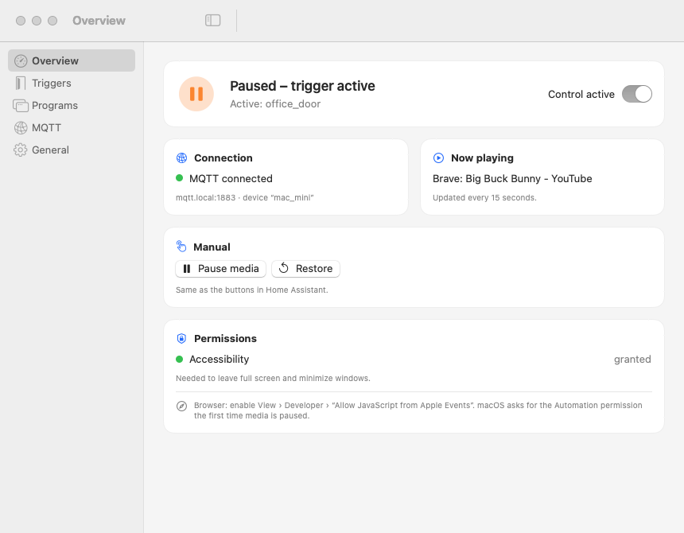
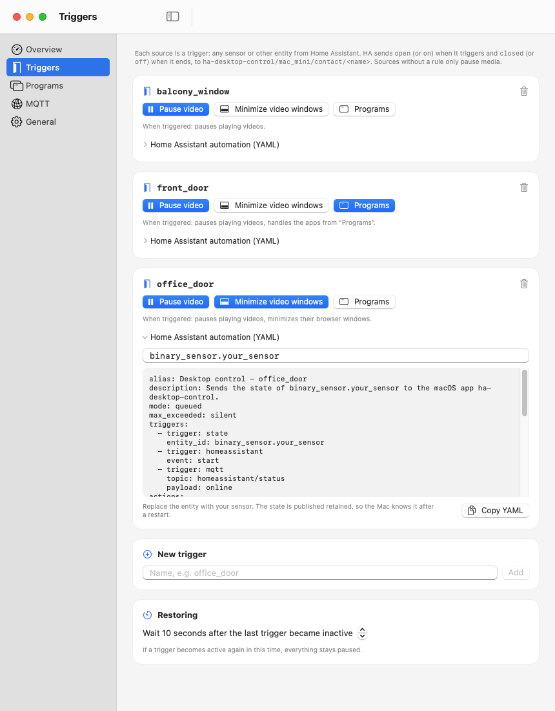

<div align="center">


</div>

# HA Desktop Control

**A native macOS menu bar app that pauses your browser video and minimizes windows when any Home Assistant sensor triggers, and puts everything back when it clears.**

[](https://github.com/sphings79/ha-desktop-control/actions/workflows/ci.yml)
[](https://github.com/sphings79/ha-desktop-control/releases/latest)
[](LICENSE)
[](https://github.com/sphings79/ha-desktop-control/stargazers)
[](#requirements)
[](https://buymeacoffee.com/sphings)

**English** · [Deutsch](README.de.md)

## Why this exists

Your Mac has no idea that someone just opened the door. You are in the middle of a movie at your desk, the door opens, and the screen shows exactly what you did not want to be seen, while the sound keeps playing.

Home Assistant knows about the door, the window, the motion in the hallway, the doorbell. Your Mac does not. HA Desktop Control closes that gap: Home Assistant tells your Mac over MQTT, the video pauses, the browser window goes out of sight, and a few seconds after the trigger ends everything comes back exactly as it was.

<div align="center">
<picture>
  <source media="(prefers-color-scheme: dark)" srcset="docs/screenshot-overview-dark.png">
  
</picture>
</div>

## Contents

- [What it does](#what-it-does)
- [Which sensors can trigger it](#which-sensors-can-trigger-it)
- [How it works](#how-it-works)
- [Supported browsers and streaming sites](#supported-browsers-and-streaming-sites)
- [Requirements](#requirements)
- [Install](#install)
- [Setup](#setup)
- [Settings reference](#settings-reference)
- [MQTT topics](#mqtt-topics)
- [Privacy and security](#privacy-and-security)
- [Troubleshooting](#troubleshooting)
- [FAQ](#faq)
- [Contribute and support](#contribute-and-support)
- [License](#license)

## What it does

When a trigger becomes active, the app pauses every playing `<video>` and `<audio>` element in your Chromium-based browsers (Brave, Vivaldi, Chrome), even if the video is in full screen. It can then minimize exactly the browser windows that played the video, and it can hide, minimize or quit other apps you choose, such as a chat client.

When the last active trigger clears, the app waits for a configurable delay, brings the windows back and resumes the videos. It only undoes what it did itself: if you pressed play yourself in the meantime, nothing is touched twice, and if two triggers overlap, it restores only after the last one has cleared.

Each trigger has its own rules, so the office door can pause video and hide the browser window while the balcony window only pauses. The Mac appears in Home Assistant as a device through MQTT Discovery, with an on/off switch, a status sensor, a "now playing" sensor and two buttons, and it reads the retained trigger state again after a restart or reconnect. The app is written in Swift and SwiftUI, starts at login if you want, keeps the broker password in the macOS Keychain, supports TLS 1.2 and newer, and follows the system light or dark appearance, or a fixed one. The interface is available in English and German.

## Which sensors can trigger it

Anything Home Assistant can express as on or off. The app does not care what the entity is; it only receives `open` or `closed` on a topic:

- door and window contacts
- motion and presence sensors, for example "someone entered the room"
- a doorbell, a button or a switch
- a person arriving or leaving, a calendar event, a schedule
- any template or helper you build, such as "bed occupied" or "meeting running"

`open` (or `on`, `true`, `1`) means the trigger is active. `closed` (or `off`, `false`, `0`) means it has cleared. The topic still says `contact` for historical reasons.

## How it works

```
Any HA sensor ──► Home Assistant ──► MQTT broker ──► HA Desktop Control (macOS)
 binary_sensor      automation        retained            │
 motion, door ...   mqtt.publish      open | closed       ├─ pause <video>/<audio> in browser tabs
                                                          ├─ minimize the window that played it
                                                          └─ hide / minimize / quit chosen apps
```

## Supported browsers and streaming sites

| Browser | Status |
|---|---|
| Brave | Tested |
| Vivaldi | Tested (YouTube) |
| Google Chrome | Same AppleScript interface as Brave, not tested here |
| Safari | Not supported yet |
| Opera GX | Not possible: its AppleScript dictionary disables JavaScript execution |

Tested with YouTube, Netflix, Disney+ and Prime Video in Brave, including full screen. Pausing works on the media elements of the page, so other streaming sites usually work as well.

A video in full screen is left first so that its window can be minimized. Browsers allow video full screen only after a real click, so the app cannot bring it back; the window returns without full screen.

## Requirements

- macOS 14 (Sonoma) or newer, tested on macOS 27 with Apple silicon
- Home Assistant with the MQTT integration, and an MQTT broker such as Mosquitto
- In each browser: **View › Developer › Allow JavaScript from Apple Events**
- To build from source: Xcode with the Swift 6 toolchain

## Install

### Option 1: download the release

1. Download `HADesktopControl-<version>-macos-arm64.zip` from the [latest release](https://github.com/sphings79/ha-desktop-control/releases/latest), unzip it and move **HADesktopControl.app** to `/Applications`.
2. The app is not notarized (ad-hoc signed). On first launch, right-click it and choose **Open**, or run:
   ```sh
   xattr -dr com.apple.quarantine /Applications/HADesktopControl.app
   ```

Requires Apple silicon (arm64) and macOS 14 or newer.

### Option 2: build from source

```sh
git clone https://github.com/sphings79/ha-desktop-control.git
cd ha-desktop-control
swift test                      # optional: run the unit tests
./scripts/build_app.sh          # creates build/HADesktopControl.app
ditto build/HADesktopControl.app /Applications/HADesktopControl.app
open /Applications/HADesktopControl.app
```

Sign with a stable certificate, otherwise macOS asks for your permissions again after every rebuild:

```sh
SIGN_IDENTITY="<certificate name or hash>" ./scripts/build_app.sh
```

A free *Apple Development* certificate from Xcode is enough (`security find-identity -v -p codesigning`).

## Setup

1. Start the app. A window icon appears in the menu bar.
2. **Settings › MQTT:** enter host, port, user and password, choose a **device ID** (for example `mac_mini`) and click *Save & connect*.
3. **Settings › Overview:** grant the **Accessibility** permission. It is needed to leave full screen and to minimize windows.
4. In your browser, enable **Allow JavaScript from Apple Events**. macOS asks for the **Automation** permission the first time media is paused.
5. **Settings › Triggers:** add a trigger (its name is the last part of the topic) and choose what it does.
6. Open **Home Assistant automation (YAML)** under the trigger, enter your sensor's entity ID and copy the generated automation into Home Assistant (see below).

<div align="center">
<picture>
  <source media="(prefers-color-scheme: dark)" srcset="docs/screenshot-contacts-dark.png">
  
</picture>
</div>

### Home Assistant setup

The app publishes an MQTT Discovery device on its own. **The app can write the automation for you:** under each trigger on the *Triggers* page, *Home Assistant automation (YAML)* shows a ready automation for your entity ID with a copy button. For each trigger, create one automation that publishes its state **retained**. Retained means the Mac learns the current state after a restart or a lost connection:

```yaml
alias: Desktop control - office door
mode: queued
max_exceeded: silent
triggers:
  - trigger: state
    entity_id: binary_sensor.office_door_contact
  - trigger: homeassistant
    event: start
  - trigger: mqtt
    topic: homeassistant/status
    payload: online
actions:
  - choose:
      - conditions:
          - condition: state
            entity_id: binary_sensor.office_door_contact
            state: "on"
        sequence:
          - action: mqtt.publish
            data:
              topic: ha-desktop-control/mac_mini/contact/office_door
              payload: open
              retain: true
      - conditions:
          - condition: state
            entity_id: binary_sensor.office_door_contact
            state: "off"
        sequence:
          - action: mqtt.publish
            data:
              topic: ha-desktop-control/mac_mini/contact/office_door
              payload: closed
              retain: true
```

Replace the entity, the device ID (`mac_mini`) and the trigger name (`office_door`). For a motion or presence sensor, use that entity instead; its `on` state becomes `open`. More examples are in [`ha/`](ha/).

## Settings reference

| Page | Setting | Effect |
|---|---|---|
| MQTT | Host, port, user, password, TLS | Broker connection; the password goes to the Keychain |
| MQTT | Device ID | Part of every topic and the HA device name |
| Triggers | Name | Last part of `…/contact/<name>` |
| Triggers | Pause video | Pauses playing media in the selected browsers |
| Triggers | Minimize video windows | Minimizes the browser windows that held a paused video |
| Triggers | Programs | Applies the rules of the Programs page |
| Triggers | Restore delay | Seconds to wait after the last trigger cleared (default 10) |
| Programs | App, action | Minimize, hide or quit; optional restore or relaunch |
| General | Browsers | Which Chromium browsers are controlled |
| General | Appearance | System, light or dark |
| General | Language | System, English or German |
| General | Start at login | Launches the app when you sign in |
| General | Updates | Daily check for a new release on GitHub (can be switched off), plus the installed version |

Triggers without a rule fall back to *pause video* only.

## MQTT topics

Prefix: `ha-desktop-control/<device_id>`

| Topic | Direction | Payload | Retained |
|---|---|---|---|
| `…/contact/<name>` | HA → app | `open` / `closed` (`on` / `off` also work) | yes |
| `…/enabled/set` | HA → app | `ON` / `OFF` | no |
| `…/cmd/pause_media` | HA → app | `PRESS` | no |
| `…/cmd/restore` | HA → app | `PRESS` | no |
| `…/availability` | app → HA | `online` / `offline` (last will) | yes |
| `…/enabled` | app → HA | `ON` / `OFF` | yes |
| `…/status` | app → HA | `idle` / `paused_by_contact` | yes |
| `…/now_playing` | app → HA | tab title or `none` | yes |

## Privacy and security

- The app talks to your own MQTT broker. There is no cloud service and no telemetry. The only other connection is the optional daily update check: one request to `api.github.com` that shows GitHub your IP address and the app version. Switch it off under *General*.
- The broker password lives in the macOS Keychain, never in the config file.
- The config file (`~/Library/Application Support/ha-desktop-control/config.json`) holds no secrets.
- The "now playing" sensor publishes the title of the playing browser tab to your broker.
- Use TLS on the broker if it is reachable beyond your trusted network.

## Troubleshooting

| Problem | What to check |
|---|---|
| Video is not paused | *Allow JavaScript from Apple Events* in the browser; the Automation permission for HA Desktop Control in System Settings › Privacy & Security |
| Window is not minimized | Accessibility permission (the Overview page shows its state) |
| Permission lost after an update | Sign with a stable certificate, see [Install](#install) |
| No device in Home Assistant | MQTT integration enabled, discovery prefix `homeassistant`, connection state in the menu |
| Nothing happens on a trigger | The topic must be `ha-desktop-control/<device_id>/contact/<name>`; an unknown name only pauses video |

## FAQ

**Can I use sensors other than door and window contacts?**
Yes. Any entity that Home Assistant can turn into on or off works: motion, presence, a doorbell, a button, a schedule. See [Which sensors can trigger it](#which-sensors-can-trigger-it).

**Does it work with Opera GX or Safari?**
Not at the moment. Opera GX switched off JavaScript execution in its AppleScript interface, and Safari support is not implemented yet. Brave, Vivaldi and Chrome work.

**Why is my video not in full screen after the window comes back?**
Browsers allow video full screen only after a real click. The app leaves full screen to minimize the window, and cannot enter it again on its own.

**What if I press play while a trigger is still active?**
The app does not pause again and does not touch that video when the trigger clears.

**Does it work with Spotify or Apple Music?**
Not yet. It targets video and audio in browsers, through the media elements of the page.

**Does it work on Windows or Linux?**
No, it is macOS only. The core with MQTT and rules is separate from the platform code, so a port is possible later.

**Why MQTT and not a webhook?**
Retained messages let the Mac catch up on the current state after a restart, and the broker you run for Home Assistant is all you need.

**How do I know there is a new version?**
The installed version is shown at the bottom of the menu and on *General › About*. The app checks GitHub once a day, shows *Update available* in the menu and on the overview page, and the *Download* button opens the release page. It does not install anything by itself.

**Which languages does the app speak?**
English and German. It follows the macOS language by default; you can pick one under *General › Language*.

**Do I need to keep granting permissions after updates?**
Only with the ad-hoc signed release, because macOS treats every build as a new app. Building from source with a stable certificate avoids that.

## Contribute and support

Issues and ideas are welcome. To build and test:

```sh
swift build
swift test          # unit tests: rule engine, topics, config, MQTT bridge
```

The project is split into `DesktopControlCore` (rules, topics, discovery, MQTT bridge; platform independent) and `HADesktopControl` (macOS: AppleScript, Accessibility, user interface). Design notes and test results are in [`PLAN.md`](PLAN.md) (German). MQTT is handled with [MQTT-Nio](https://github.com/swift-server-community/mqtt-nio) (Apache-2.0).

If this saves you from a movie night that someone else walked in on:

- ⭐ **Star this repository.** It helps others find it.
- ☕ **[Buy me a coffee](https://buymeacoffee.com/sphings)** if you want to support further development.

## License

[MIT](LICENSE) © sphings79

<sub>home assistant macos · pause video home assistant · mqtt macos menu bar app · home assistant door sensor mac · pause youtube netflix disney prime video automatically · minimize browser window home assistant · macos media control mqtt · home assistant presence mac privacy · swift swiftui menu bar · brave vivaldi chrome applescript · mqtt discovery</sub>
