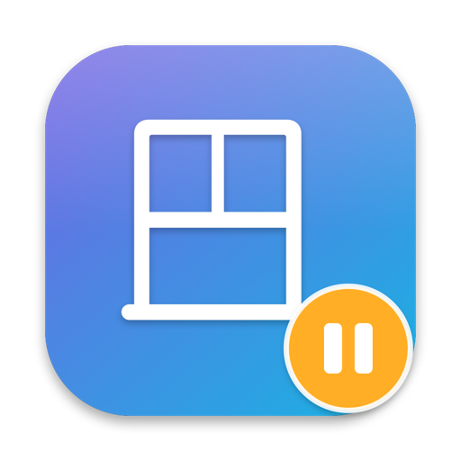

<div align="center">



# HA Desktop Control

**Pause YouTube, Netflix & co. and minimize browser windows on your Mac when a Home Assistant door or window contact opens.**

A native macOS menu bar app that listens to Home Assistant over MQTT.

[](#requirements)
[](Package.swift)
[](#home-assistant-setup)
[](https://github.com/sphings79/ha-desktop-control/releases/latest)
[](LICENSE)
[](https://buymeacoffee.com/sphings)

**English** · [Deutsch](README.de.md)

</div>

---

## What it does

You open a door or window, and your Mac reacts: the video you were watching stops, and the browser window that played it goes out of sight. When the contact closes again, everything comes back exactly as it was.

HA Desktop Control connects your Mac to **Home Assistant** through **MQTT**. A door, window or any other `binary_sensor` publishes `open` or `closed`; the app pauses media in your browser and optionally minimizes, hides or quits configured apps. It only undoes what it did itself.

**Typical uses**

- Pause Netflix, YouTube, Disney+ or Prime Video on your Mac when someone opens the office door.
- Hide the video window when a window contact opens, and bring it back when it closes.
- Shield your screen at the home office when someone walks in (privacy).
- Any Home Assistant automation that should control media playback or windows on macOS.

## Features

- **Pause and resume browser video** in Chromium-based browsers (Brave, Vivaldi, Chrome) via AppleScript, including videos in full screen.
- **Minimize the browser window that played the video** (not all windows), leaving full screen first.
- **Hide, minimize or quit any app** per contact, with optional restore.
- **Per-contact rules:** different doors and windows can trigger different actions.
- **Safe undo:** only restores what the app paused or minimized itself; if you press play manually in the meantime, nothing is touched twice.
- **Restore delay** after the last contact closes (default 10 s); reopening cancels it.
- **Multiple contacts at once:** restores only after the last one is closed.
- **Home Assistant MQTT Discovery:** the Mac shows up as a device with an on/off switch, a status sensor, a "now playing" sensor and two buttons.
- **Retained contact states:** the app picks up the current state after a restart or reconnect.
- **Native menu bar app** in Swift/SwiftUI with a settings window, start at login, and the broker password stored in the macOS Keychain.
- **TLS (1.2+)** support and automatic reconnect with backoff.

## How it works

```
Door / window sensor ──► Home Assistant ──► MQTT broker ──► HA Desktop Control (macOS)
   binary_sensor           automation        retained            │
                           mqtt.publish      open | closed       ├─ pause <video>/<audio> in browser tabs
                                                                 ├─ minimize the window that played it
                                                                 └─ hide / minimize / quit configured apps
```

## Supported browsers and services

| Browser | Status |
|---|---|
| Brave | Tested |
| Vivaldi | Tested (YouTube) |
| Google Chrome | Same AppleScript interface as Brave, not tested here |
| Safari | Not supported yet |
| Opera GX | Not possible: its AppleScript dictionary disables JavaScript execution |

Tested with YouTube, Netflix, Disney+ and Prime Video in Brave, including full screen. RTL+ is untested. Pausing works on the `<video>` and `<audio>` elements of the page, so other streaming sites usually work too.

> **Full screen:** a video that is in full screen is left first so the window can be minimized. Browsers only allow video full screen after a real click, so the app cannot restore it; the window comes back without full screen.

## Requirements

- macOS 14 (Sonoma) or newer, tested on macOS 27 with Apple silicon
- Xcode / Swift 6 toolchain to build from source
- Home Assistant with the **MQTT integration** and an MQTT broker (for example Mosquitto)
- In each browser: **View › Developer › Allow JavaScript from Apple Events**

## Install

### Option 1: download the release

1. Download `HADesktopControl-<version>-macos-arm64.zip` from the [latest release](https://github.com/sphings79/ha-desktop-control/releases/latest), unzip it and move **HADesktopControl.app** to `/Applications`.
2. The app is **not notarized** (ad-hoc signed). On first launch, right-click it and choose **Open**, or run:
   ```sh
   xattr -dr com.apple.quarantine /Applications/HADesktopControl.app
   ```

Requires Apple silicon (arm64) and macOS 14+.

### Option 2: build from source

```sh
git clone https://github.com/sphings79/ha-desktop-control.git
cd ha-desktop-control
swift test                      # optional: run the unit tests
./scripts/build_app.sh          # creates build/HADesktopControl.app
ditto build/HADesktopControl.app /Applications/HADesktopControl.app
open /Applications/HADesktopControl.app
```

**Tip:** sign with a stable certificate, otherwise macOS asks for your permissions again after every rebuild:

```sh
SIGN_IDENTITY="<certificate name or hash>" ./scripts/build_app.sh
```

A free *Apple Development* certificate from Xcode is enough (`security find-identity -v -p codesigning`).

## Setup

1. Start the app. A window icon appears in the menu bar.
2. **Settings › MQTT:** enter host, port, user and password, set a **device ID** (for example `mac_mini`), and click *Save & connect*.
3. **Settings › Overview:** grant the **Accessibility** permission (needed to leave full screen and minimize windows).
4. In your browser, enable **Allow JavaScript from Apple Events**. macOS asks for the **Automation** permission the first time media is paused.
5. **Settings › Contacts:** add a contact (the name is the last part of the topic) and choose its actions.

### Home Assistant setup

The app publishes an MQTT Discovery device automatically. For each contact, create one automation that publishes the state **retained**:

```yaml
alias: Desktop control - office door
mode: queued
max_exceeded: silent
triggers:
  - trigger: state
    entity_id: binary_sensor.office_door_contact
  - trigger: homeassistant
    event: start
  - trigger: mqtt
    topic: homeassistant/status
    payload: online
actions:
  - choose:
      - conditions:
          - condition: state
            entity_id: binary_sensor.office_door_contact
            state: "on"
        sequence:
          - action: mqtt.publish
            data:
              topic: ha-desktop-control/mac_mini/contact/office_door
              payload: open
              retain: true
      - conditions:
          - condition: state
            entity_id: binary_sensor.office_door_contact
            state: "off"
        sequence:
          - action: mqtt.publish
            data:
              topic: ha-desktop-control/mac_mini/contact/office_door
              payload: closed
              retain: true
```

Replace the entity, the device ID (`mac_mini`) and the contact name (`office_door`). More examples are in [`ha/`](ha/).

## MQTT topics

Prefix: `ha-desktop-control/<device_id>`

| Topic | Direction | Payload | Retained |
|---|---|---|---|
| `…/contact/<source>` | HA → app | `open` / `closed` (`on` / `off` also work) | yes |
| `…/enabled/set` | HA → app | `ON` / `OFF` | no |
| `…/cmd/pause_media` | HA → app | `PRESS` | no |
| `…/cmd/restore` | HA → app | `PRESS` | no |
| `…/availability` | app → HA | `online` / `offline` (last will) | yes |
| `…/enabled` | app → HA | `ON` / `OFF` | yes |
| `…/status` | app → HA | `idle` / `paused_by_contact` | yes |
| `…/now_playing` | app → HA | tab title or `none` | yes |

## Actions per contact

| Action | Effect |
|---|---|
| Pause video | Pauses all playing media elements in the configured browsers |
| Minimize video windows | Minimizes the browser windows that contained the paused video |
| Programs | Applies the rules from the *Programs* page: minimize, hide or quit |

Unknown contacts fall back to *pause video* only.

## Privacy and security

- The app only talks to **your own MQTT broker**. There is no cloud service and no telemetry.
- The broker password lives in the **macOS Keychain**, never in the config file.
- The config file (`~/Library/Application Support/ha-desktop-control/config.json`) has no secrets.
- The "now playing" sensor publishes the title of the playing browser tab to your broker.
- Use TLS on the broker if it is reachable beyond your trusted network.

## Troubleshooting

| Problem | What to check |
|---|---|
| Video is not paused | *Allow JavaScript from Apple Events* in the browser; Automation permission for HA Desktop Control in System Settings › Privacy & Security |
| Window is not minimized | Accessibility permission (Overview page shows its state) |
| Permission lost after an update | Sign with a stable certificate, see [Install](#install) |
| No device in Home Assistant | MQTT integration enabled, discovery prefix `homeassistant`, check the menu for the connection state |
| Nothing happens on a contact | Topic must match `ha-desktop-control/<device_id>/contact/<name>`; the name needs a rule or falls back to *pause video* |

## FAQ

**Can I control Home Assistant media players from the Mac?** No, this app goes the other way: Home Assistant controls the Mac.

**Does it work with Spotify or Apple Music?** Not yet. It targets video in browsers via the page's media elements.

**Does it work on Windows or Linux?** No, it is macOS-only. The core (MQTT, rules) is separated from the platform code, so a port is possible later.

**Why MQTT and not a webhook?** Retained messages let the Mac catch up on the current contact state after a restart, and the broker you already run for Home Assistant is all you need.

## Development

```sh
swift build
swift test          # 24 unit tests: rule engine, topics, config, MQTT bridge
```

The project is split into `DesktopControlCore` (rules, topics, discovery, MQTT bridge; platform-independent) and `HADesktopControl` (macOS: AppleScript, Accessibility, UI). The design notes and test results are in [`PLAN.md`](PLAN.md) (German).

MQTT is handled with [MQTT-Nio](https://github.com/swift-server-community/mqtt-nio) (Apache-2.0).

## Support the project

If HA Desktop Control saves you from a paused-too-late movie night, please:

- ⭐ **Star this repository** — it helps others find it.
- ☕ **[Buy me a coffee](https://buymeacoffee.com/sphings)** if you want to support further development.

Issues and ideas are welcome.

## License

[MIT](LICENSE) © sphings79
